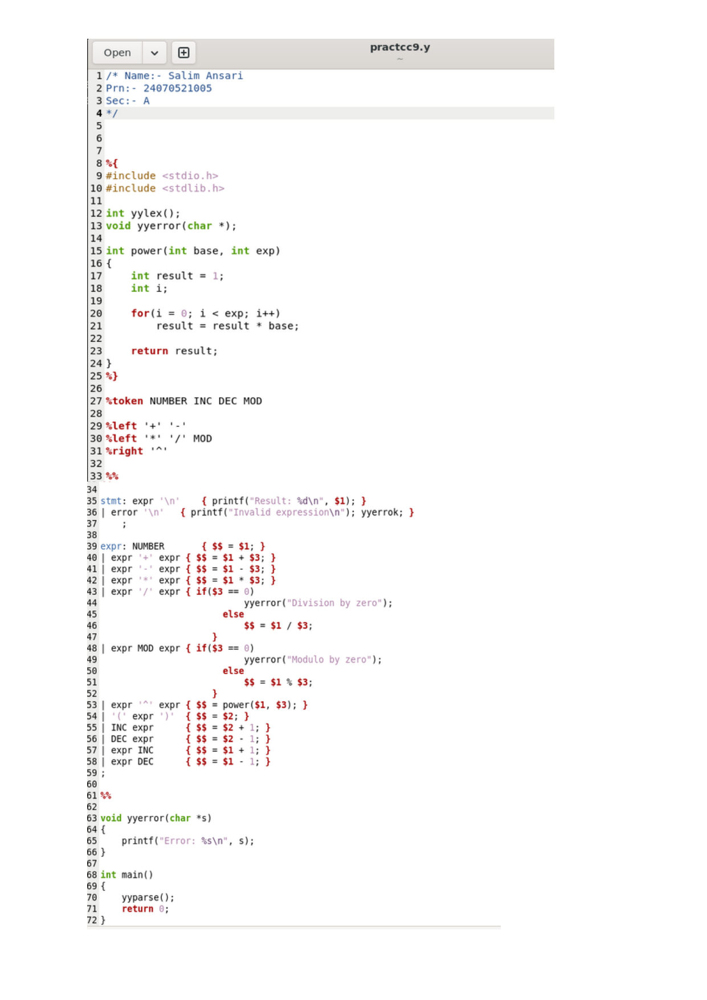
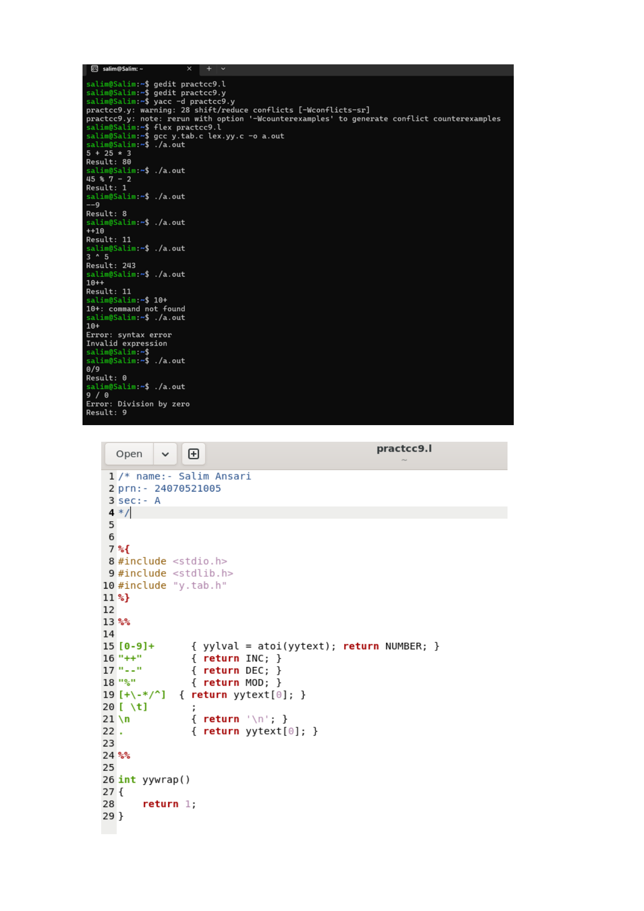

# Practical 9: Infix Arithmetic Expression Evaluation with Precedence & Unary Operators

> **Student Name:** Salim Ansari | **PRN:** 24070521005 | **Batch:** A1

## 📋 Description
A YACC & LEX program to evaluate infix arithmetic expressions handling operator precedence (+, -, *, /, %, ^), parentheses, and increment/decrement operators (++ and --).

## 📁 Source Files
- [`exp9.l`](./exp9.l)
- [`exp9.y`](./exp9.y)

## 🚀 How to Run
```bash
# 1. Generate YACC parser files
bison -d -y exp9.y

# 2. Generate LEX scanner files
flex exp9.l

# 3. Compile both together with GCC
gcc y.tab.c lex.yy.c -o exp9

# 4. Execute the binary
./exp9
```

## 🖥️ Output / Execution Screenshot





📄 **Full PDF Lab Report:** [`Practical-09.pdf`](./Practical-09.pdf)
