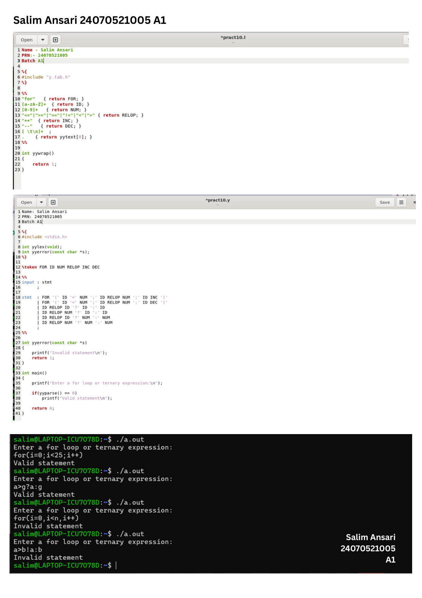

# Practical 10: For Loop and Ternary Expression Syntax Validation

> **Student Name:** Salim Ansari | **PRN:** 24070521005 | **Batch:** A1

## 📋 Description
A YACC & LEX program to check the syntactic validity of C-style `for` loops and conditional ternary expressions (`condition ? expr1 : expr2`).

## 📁 Source Files
- [`exp10.l`](./exp10.l)
- [`exp10.y`](./exp10.y)

## 🚀 How to Run
```bash
# 1. Generate YACC parser files
bison -d -y exp10.y

# 2. Generate LEX scanner files
flex exp10.l

# 3. Compile both together with GCC
gcc y.tab.c lex.yy.c -o exp10

# 4. Execute the binary
./exp10
```

## 🖥️ Output / Execution Screenshot



📄 **Full PDF Lab Report:** [`Practical-10.pdf`](./Practical-10.pdf)
