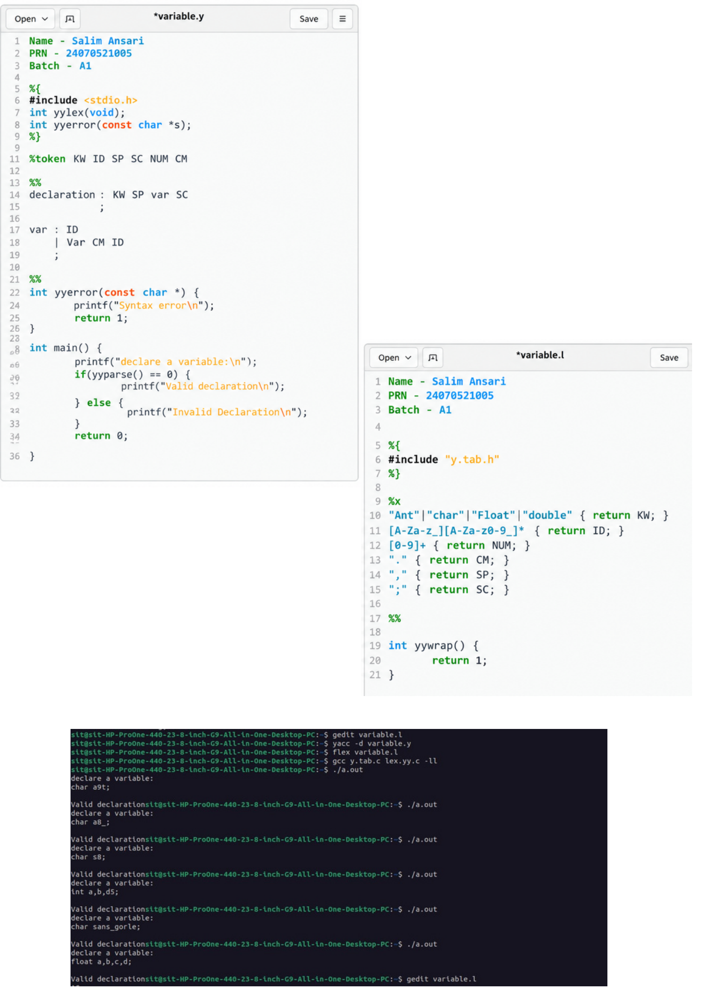

# Practical 11: Variable Declaration Syntax Validation

> **Student Name:** Salim Ansari | **PRN:** 24070521005 | **Batch:** A1

## 📌 Description
A YACC & LEX program to check the syntactic validity of C-style variable declarations (e.g., `int a9t;`, `char sans_gorle;`, `float a,b,c,d;`, `int a,b,d5;`) supporting standard data types (`int`, `char`, `float`, `double`), single or comma-separated identifier lists, and semicolon statement termination.

## 📁 Source Files
- [`variable.l`](./variable.l) - Lexical analyzer specification
- [`variable.y`](./variable.y) - Yacc/Bison context-free grammar and parser

## 🚀 How to Run
```bash
# 1. Generate YACC parser files
yacc -d variable.y
# or using bison:
bison -d -y variable.y

# 2. Generate LEX scanner files
flex variable.l

# 3. Compile both generated C source files with GCC
gcc y.tab.c lex.yy.c -ll -o variable

# 4. Execute the binary
./variable
```

## 📸 Output / Execution Screenshot



📄 **Full PDF Lab Report:** [`Practical-11.pdf`](./Practical-11.pdf)
