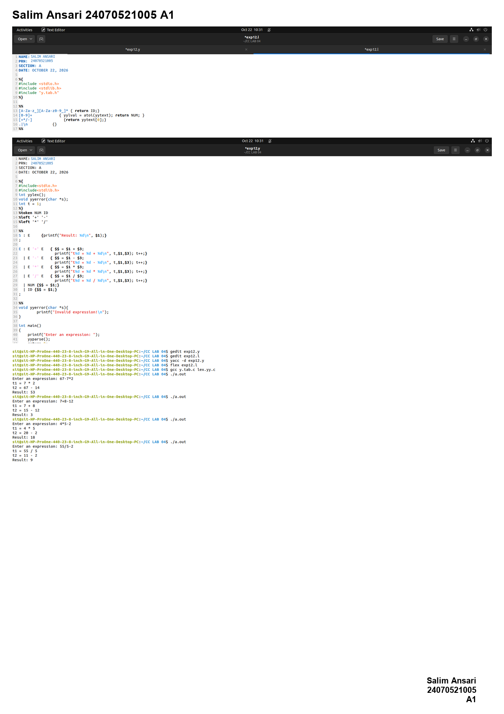

# Practical 12: Intermediate Code Generation (ICG) for Arithmetic Expressions

> **Student Name:** Salim Ansari | **PRN:** 24070521005 | **Batch:** A1

## 📌 Description
A Lex & YACC program to generate intermediate three-address style code (`t1 = ...`, `t2 = ...`) for arithmetic expressions evaluated bottom-up with standard operator precedence (`*`, `/` higher than `+`, `-`).

## 📁 Source Files
- [`exp12.l`](./exp12.l) - Lexical analyzer scanner
- [`exp12.y`](./exp12.y) - Yacc/Bison context-free grammar and three-address code generator

## 🚀 How to Run
```bash
# 1. Generate YACC parser files
yacc -d exp12.y
# or using bison:
bison -d -y exp12.y

# 2. Generate LEX scanner files
flex exp12.l

# 3. Compile generated C source files
gcc y.tab.c lex.yy.c -o exp12

# 4. Execute the binary
./exp12
```

## 📸 Output / Execution Screenshot



📄 **Full PDF Lab Report:** [`Practical-12.pdf`](./Practical-12.pdf)
